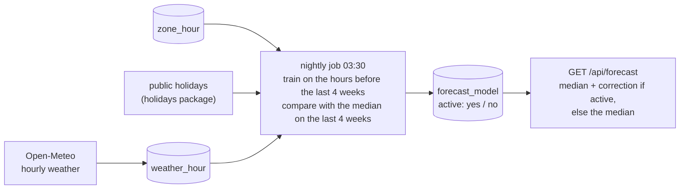

# Smarter forecast (P9.6)

`GET /api/forecast` answers "how many spaces will be free at 9:10?". Since P7.6 the answer is the **median** of the same weekday and hour over the last 8 weeks. That is wrong on the days that are not like the last 8 weeks: a public holiday, the day before one, a rainy morning. P9.6 adds a small model that corrects the median on those days, and **uses it only while it is measurably better than the median alone**.



## 1. What changes for whom

- **Drivers:** the Stats card says *"Probably ~N free at HH:MM"* (model) instead of *"Usually ~N free at HH:MM"* (median). Nothing else.
- **A fresh installation:** nothing. The model needs about 9 weeks of history before it can even be checked; until then, and whenever it doesn't beat the median, the answer is the P7.6 median, unchanged.
- **Operators:** a `forecast:` section in lot.yaml ([config.md §1](config.md#1-configlotyaml)), a nightly job, `parking forecast train` / `status`.

## 2. The model

The target is **how far the hour's `free_avg` ends up from the median** (`free_avg − median`), so a model that learns nothing is exactly the median. One model per zone and one for the lot's total.

| Feature | From |
|---------|------|
| `hour`, `weekday`, `month` | the lot-local time (lot.yaml `timezone`) |
| `holiday`, `holiday_eve`, `holiday_after` (0/1) | is the lot-local day a public holiday, the day before one, the day after one |
| `median`, `spread` | the 8-week median itself and max − min of its samples (how steady this hour usually is) |
| `temp_c`, `precip_mm` | the hour's temperature and rain from `weather_hour`; missing when weather is off or not fetched |

The model is gradient-boosted regression trees (`parking/forecast/gbm.py`, ~150 lines of numpy): squared loss, 150 trees of depth 3, learning rate 0.05, at least 24 hours per leaf, 80% of the rows per tree, at most 32 split points per feature. A missing value always takes the right branch, in training and in prediction. **The settings are fixed, not tuned**, so the held-out weeks are never used to choose anything. It is stored as JSON (feature names + trees, ~80 KB), never pickled. Training a zone takes 1–3 s on the dev Pi for 30–52 weeks of hours.

Why not scikit-learn / LightGBM: tens of MB in the API image for a model this small; the data is at most ~9 000 rows a year per zone.

## 3. Calendar and weather

**Holidays** come from the [`holidays`](https://pypi.org/project/holidays/) Python package (MIT, offline, pure Python) for the country in `forecast.holidays` (ISO 3166-1 alpha-2, e.g. `RO`; `holidays_subdiv` for a region). `forecast.extra_holidays` adds the lot's own dates (a company closure). Without a country the three holiday features are always 0.

**Weather** comes from [Open-Meteo](https://open-meteo.com/) (`parking/forecast/weather.py`) when `forecast.weather: true`:

- One request a night to `api.open-meteo.com/v1/forecast` (`hourly=temperature_2m,precipitation`, UTC): the last 7 days and the next 7. The first time, or after a gap, the last 92 days. Once, when `zone_hour` reaches further back than that, `archive-api.open-meteo.com/v1/archive` for the older hours.
- **What is sent: the lot's coordinates rounded to 2 decimals (~1 km). No key, no account, nothing about users.**
- Stored in `weather_hour` ([data-model.md](data-model.md#weather_hour--forecast_model-the-forecast-model-p96)); a later run replaces forecast hours with the measured ones. The model is trained on measured weather and asked with forecast weather, which is what it would have had in real use only approximately; the held-out check uses stored (measured) weather too, so a weather gain is slightly optimistic.
- A failed request is logged and training goes on with the stored hours. An hour without weather is just a missing value.
- **Licence:** Open-Meteo's free API is for **non-commercial use**, data CC BY 4.0 (the app shows "Weather data by Open-Meteo.com" under a forecast that used it). For a commercial installation: their paid API, or `weather: false`.

`/api/forecast` knows the weather up to 7 days ahead; further out (or with weather off) the model answers from the calendar features alone. The median needs the 8 weeks before `at`, so nothing can be asked more than ~5 weeks ahead anyway.

## 4. The check: "only if it beats the median"

Every night, per zone (`parking/forecast/model.py` `train`):

1. Take every `zone_hour` row with at least 30 minutes of data that has a median (≥ 3 of the 8 same weekday/hours before it).
2. Split by time: **the last 28 days are held out**; the model is trained on the hours before them. Needs ≥ 336 hours (2 weeks) on each side, else no model (`not enough history`).
3. On the held-out hours compare the **mean absolute error, in spaces, of what would have been served** (rounded, within 0…capacity): model vs median.
4. `active` only if `MAE(model) < 0.97 × MAE(median)` (3% better, so noise alone doesn't switch it on). Then the model is refitted on all hours, held-out ones included, and stored.
5. The result is stored either way in `forecast_model` (both errors, the hours used, a note). A model that fails tonight replaces yesterday's active one.

`/api/forecast` uses a zone's model only if it is `active`, was trained in the last 3 days (the job is alive) and was built from the same feature list as the running code. Otherwise: the median.

The guide says "a held-out month"; 28 days are used so that every weekday is held out equally often.

## 5. Running it

| What | How |
|------|-----|
| Nightly | job `forecast`, 03:30 lot time, in the API ([data-model.md §4](data-model.md#4-retention-and-rollups-apscheduler-jobs-in-the-api)); for every lot with `forecast.model: true` |
| Now | `parking forecast train` (same code; prints the table below) |
| What is in use | `parking forecast status` |
| Off | `forecast: { model: false }`: no job, no model, the median |

For example:

```text
last trained: 2026-10-10 20:36 UTC
zone                  hours held out MAE model MAE median  used
ground                 4537      672      1.84       1.91  model (beats the median on the last 4 weeks)
total                  4537      672      1.68       1.72  median (does not beat the median on the last 4 weeks)
```

With several lots ([multi-lot.md](multi-lot.md)) `forecast:` is shared by all of them (like `api:`); each lot gets its own weather (its coordinates) and its own models (`total@<lot>` for a non-default lot's total).

## 6. API

`GET /api/forecast` ([api.md §2](api.md#2-public-rest-endpoints)) gains two fields; nothing is removed:

```json
{ "zone": "ground", "at": "2026-10-12T09:10:00.000Z", "free_expected": 23,
  "method": "model",
  "basis": "median of last 8 same weekday/hour + model (calendar, holidays, weather)",
  "samples": 8, "weather": true }
```

`method` is `median` or `model`; `weather` is true when the model uses the weather and had it for that hour. `404 not_enough_data` is as before (the model needs the median too).

## 7. Not built, and why

- **"What it is right now" as a feature** (the count 30 minutes ago). It would help the next-hour answer most, but `zone_hour` only knows whole past hours and `at` can be days ahead; it needs a second, short-range model. The live trend arrow already covers "right now".
- **A probability** ("80% chance of a space"). The card shows the expected count; a calibrated probability needs more data than a new lot has.
- **Per-lot `forecast:` settings** (two lots in different countries). Add when there is such a pair.
- **School holidays, events.** `extra_holidays` is the manual way in.

## 8. Tests and what was checked

- `backend/tests/unit/test_forecast_model.py` (18): the trees (a step and an interaction, missing values, JSON round trip, nothing to learn), the holiday calendar and config, the Open-Meteo client on a mocked transport (first run 92 days and rounded coordinates, weekly refresh replaces hours, archive for old history, HTTP error), features, and training on synthetic hours: used when holidays and rain move the lot, **not used when every week is alike**, not enough history, a failed night replaces an active model, unreadable / other-feature models ignored.
- `backend/tests/integration/test_forecast_model.py` (6): the job through the API's `MaintenanceJobs`; `/api/forecast` median → model, drier vs rainier hour, no weather for a far hour, the 3-day age limit; Christmas forecast emptier than the median's ordinary Fridays; a model that doesn't beat the median is not served; `model: false`; weather service down; `parking forecast train` / `status`.
- `frontend`: the Stats card for a model answer with and without weather, `isForecast` with the new fields.
- **On the dev Pi (2026-10-10), synthetic `zone_hour` only (there is no real history yet):** 30 weeks of a weekly curve + noise in a scratch database, real Open-Meteo requests (archive + recent: 5 208 hours stored), `parking forecast train` in 4.7 s for two zones. With occupancy that ignores the weather the model did not pass (MAE 1.68 vs 1.72 spaces, under the 3% margin) and the median stayed; re-seeded so rain fills the lot it passed (1.84 vs 1.91) and a throwaway API on a spare port answered `method: model`, `weather: true` in 15 ms. **This shows the chain and the gate work, not that the model helps at the real lot**: that is decided by the nightly check on real history, on its own.
