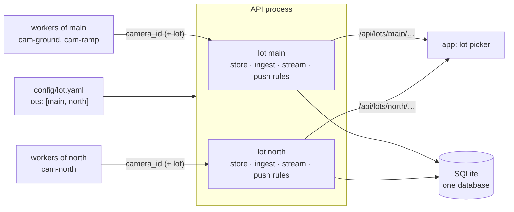

# Multiple lots (P9.5)

One installation (one API, one database, one app) can count more than one car park. A second location is a second entry in `lot.yaml`, not a second server.



A single-lot installation changes nothing: its `lot.yaml`, its paths, its database and the app look exactly as before.

## 1. What a lot is

A lot has an id, a name, a location, a notify radius, a time zone, its **zones** and its **cameras** (and barriers). Everything the app shows belongs to one lot: the status, the live stream, the slot maps, the history, the forecast, and a push subscription's rules.

Shared by every lot of an installation: the API process and its `.env` (`WORKER_TOKEN`, VAPID keys, the admin password), the database, the `api:` settings of `lot.yaml` (stale timeout, levels, …), the admin login and the admin alerts.

## 2. `lot.yaml`

Two forms ([config.md §1](config.md#several-lots-lots)): the single-lot one (`lot:`, `zones:`, `cameras:` at the top) and

```yaml
version: 1
lots:
  - id: main                       # the first lot is the default lot
    name: "Main street"
    location: { lat: ${LOT_LAT}, lon: ${LOT_LON} }
    timezone: ${TZ}
    zones: [...]                   # exactly as the top-level `zones:` of a single lot
    cameras: [...]
  - id: north
    name: "North gate"
    location: { lat: ${NORTH_LAT}, lon: ${NORTH_LON} }
    notify_radius_m: 300
    timezone: ${TZ}
    zones: [...]
    cameras: [...]
api: { ... }                       # shared
```

Rules (`load_lots` in `parking/config.py`):

- `lots:` can't be combined with a top-level `lot`, `zones` or `cameras`. Each entry is validated as a lot of its own (same rules as before), and an error names the entry: `lots[1] (north): …`.
- **Lot ids are unique. Zone ids and camera ids are unique across the whole file**, not only inside a lot: two lots can't both have a zone `ground`; name them `north-ground` or the like. That is what lets the API find a lot from a camera or zone id alone (worker payloads, admin routes) and keeps the database's zone and camera columns as they are.
- The **first lot is the default lot**: the paths without a lot (§3), subscriptions that name no lot (§5) and the rollup id `total` (§4) are its. Keep it first when adding lots.
- `LOT_LAT` / `LOT_LON` from the settings override the location of the default lot only; other lots give theirs in the file (through their own `${VAR}`s to keep them out of git).

A lot box at one location may run with a file that holds only its own lot (or the whole file): a worker reads the lot its `--camera` belongs to. The ids must match the server's file.

## 3. API

| Path | |
|------|--|
| `GET /api/lots` | `{"v": 1, "default": "main", "lots": [{"id": "main", "name": "Main street"}, …]}` in file order |
| `GET /api/lots/{lot}` | the lot's info (what `/api/lot` returns) |
| `GET /api/lots/{lot}/status`, `/stream`, `/maps/{zone}`, `/history`, `/forecast` | as the paths without a lot, for that lot; an unknown lot is `404 not_found`, and so is a zone of another lot |
| `/api/lot`, `/api/status`, `/api/stream`, `/api/maps/{zone}`, `/api/history`, `/api/forecast` | the **default lot** (kept: installed apps, scripts and the uptime check use them) |
| `/healthz` | the cameras of every lot; the ingest and stream counters are sums |
| `/internal/*` | unchanged paths. The lot is found from `camera_id`; payloads carry `lot` (the worker's lot id) and one that names another lot than its camera's is rejected with 422. Without `lot` (older workers) only the camera decides |
| `/api/admin/*` | unchanged paths: cameras and zones are found by their id in whichever lot has them; `GET /api/admin/cameras` lists every lot's with a `lot` field; corrections and alerts cover every lot |
| `/api/push/*` | unchanged paths; the subscription carries its lot (§5) |

Inside the API (`parking/api/app.py`) each lot gets its own `Runtime`: `StateStore`, `Ingestor` (and its lock and tick), SSE `Broadcaster`, history cache and push rules, built from that lot's `LotConfig`. So a lot's `LotStatus`, stream event ids and trends never mix with another's, and the code under them didn't change. `app.state.runtime` is the default lot's; `Runtime.lots` holds all of them.

## 4. Database

No table got a lot column for zones or cameras: their ids are unique across lots (§2).

- `zone_minute` / `zone_hour`: each lot has its own total pseudo-zone, **`total` for the default lot and `total@<lot id>` for the others** (`@` can't appear in a zone id). `?zone=total` in a lot's history or forecast reads that lot's.
- `push_subscription.lot_id` (migration `0008`): §5.
- One set of maintenance jobs (`MaintenanceJobs`) serves all lots; a zone's scheduled reset runs on its own lot's time zone, prune and vacuum on the default lot's.

Making an installation multi-lot later needs no data change: turn `lot:` into the first entry of `lots:` and add the others after it. **Reordering lots so that another one comes first** would swap which total is called `total`; don't (or rebuild the rollups with `parking db aggregate --backfill`).

## 5. Push subscriptions

A browser has one push subscription, and it follows **one lot**: `lot` in `POST /api/push/subscriptions` (default: the default lot) and optionally in `PATCH` (moves it). `prefs.zones` are checked against that lot's zones. The on-my-way, reminder and almost-full rules of a lot only see its own subscriptions; the test push shows the subscription's lot. Moving a subscription to another lot ends its on-my-way window.

Rows from before (`lot_id` NULL) belong to the default lot. With a single lot every subscription is served whatever its `lot_id`. A subscription whose lot was removed from `lot.yaml` gets nothing until the app moves it (§6).

Following two car parks from one phone at once is not built: it needs several subscriptions' worth of settings per browser endpoint.

Admin alerts are not per lot: an admin subscription gets the alerts of every lot (camera and zone ids say which), and the machine's own alerts (disk, temperature, restart, backup) are raised once.

## 6. The app

- `GET /api/lots` at start. With **more than one lot** the header shows a picker (a `<select>` named *Car park*) in place of the app's name; with one lot (or a server from before this) nothing changes.
- The picked lot is kept on the device (`localStorage` `parking.lot`). Until one is picked the app uses the paths without a lot, so the default lot.
- Picking a lot stores it, moves the push subscription (`PATCH` with `lot`, followed zones back to *all*, on-my-way ended) and **reloads the app**: the live connection, the screens and their caches all belong to one lot.
- If the stored lot is no longer in the list, the app goes back to the default lot by itself.
- Everything else (zone cards, map, Stats, Alerts, proximity) reads the picked lot through the same client functions (`src/api/lots.ts` → `lotPath`).
- The Admin screens show every lot's cameras and zones as one list.

The mock build (the preview without an API) has one lot, so no picker.

## 7. Not built, and why

- **Per-lot `api:` settings** (levels, stale timeout): shared for now; nothing asks for different ones.
- **Per-lot admins**: one admin login for the installation.
- **A map or a list of lots with their free counts** in the picker: the picker shows names. `/api/lots` could carry each lot's total later.
- **Several lots per subscription** (§5).
- **Compose services for another lot's cameras**: `deploy/docker-compose*.yml` name the first lot's cameras (`vision-occupancy` runs `cam-ground`, `vision-flow` runs `cam-ramp`). Another location's lot box needs those two ids changed, in a small override file: [deployment.md §4.5](deployment.md#45-several-lots-p95).

## 8. Tests and what was checked

- Backend (`tests/integration/test_multi_lot.py`): the `lots:` loader and its errors, a status per lot and the old paths as the default lot, lot info per lot, payloads routed by camera and rejected with a wrong `lot`, admin routes across lots, a rollup total per lot, subscriptions per lot (zones checked against the lot, test push, on-my-way only for the lot that changed, moving).
- Frontend: `lotPath`, the picker (one lot, several, a stored lot, a removed lot), the client's lot paths, the subscription moving with the picker.
- On the dev Pi (2026-10-10): a throwaway API on a spare port with two lots (`main`: the committed ground camera on the simulated feed, 17 spaces; `north`: a second camera on the same feed with a 9-space slot file) and one occupancy worker each. `/api/status` and `/api/lots/main/status` gave 13 free of 17, `/api/lots/north/status` 8 free of 9, each following its own worker; `zone_minute` had `total` and `total@north`; a health message for `cam-north` naming `lot: main` was rejected. The app built against it, in Chromium at 390 and 320 px: the picker listed both lots, picking *North gate* reloaded onto `/api/lots/north/status`, `/stream`, `/maps/…`, `/history` and `/forecast`, and the header still fit at 320 px. Not checked on a phone, and not with a real second location.
